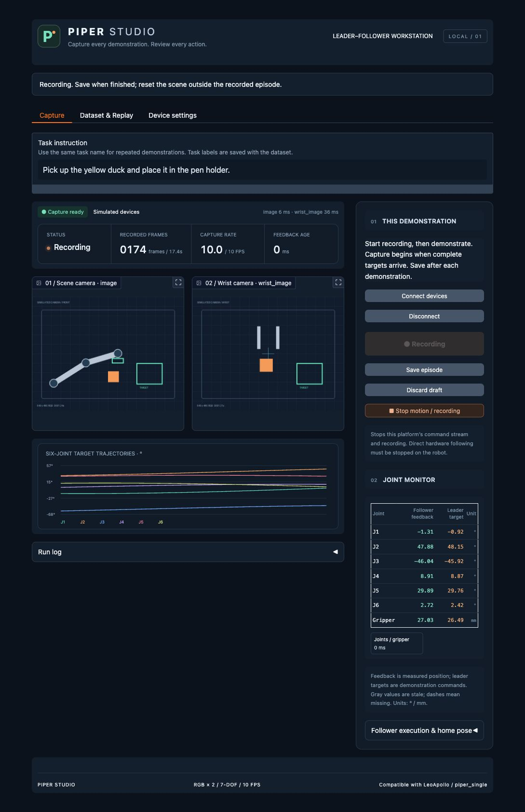
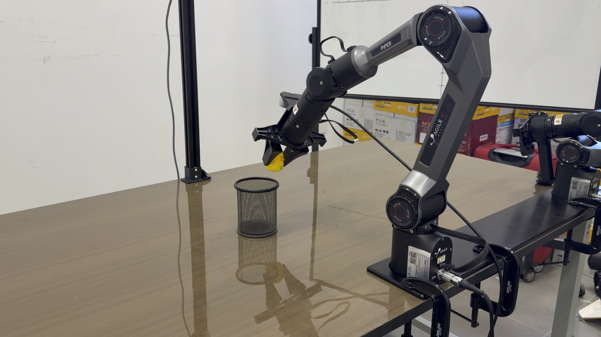

# Piper Studio

**[English](README.md) | [简体中文](README.zh-CN.md)**

面向松灵 AgileX PiPER 的本地数据采集与回放平台。实时查看场景和腕部相机、
监视主臂目标与从臂反馈，按 episode 保存示范，并逐帧检查训练数据。



**平台 UI。** 这是真实运行页面的截图，图中使用内置模拟设备。
真机模式使用同一界面展示实时相机与 CAN 数据。

实时 VLA 推理与连续动作执行代码见
[Piper Realtime VLA](https://github.com/1024AILab/piper-realtime-vla)。


## 真机平台



用户提供的 PiPER 真机平台照片：小黄鸭抓取与笔筒放置场景。


## 功能

- 两路 640×480 RGB 实时预览：场景相机与腕部相机，并检查图像新鲜度。
- 并列显示主臂目标、从臂反馈，按任务录制与保存 episode。
- 输出兼容 LeRobot v2.1 的 Parquet、任务标签与统计信息，支持中断草稿恢复。
- 逐帧画面回放、保存任务起始位、受控机械臂轨迹回放。
- 支持 Linux SocketCAN、macOS `gs_usb`，以及 Mac 独立 RealSense RGB 取图进程。

## 快速启动

推荐 **Python 3.12**。附带的 Mac 相机二进制适用于 Apple Silicon 和 CPython 3.12。
模拟演示不需要机械臂、相机或模型权重。

```bash
git clone https://github.com/1024AILab/piper-studio.git
cd piper-studio
python3.12 -m venv .venv
source .venv/bin/activate
python -m pip install -e .
python -m piper_studio.app --config configs/sim.json --connect-sim --lang zh --open
```

打开 **http://127.0.0.1:7860**，填写任务名称，点击开始录制，保存 episode，
然后到“数据与回放”检查。模拟相机画面有明确标记，模拟数据与真机数据分开保存。
界面提供英文（`--lang en`，默认）和中文（`--lang zh`）两种启动模式。切换语言后重新启动；任务标签和保存的数据不变。

不连接设备也可以查看附带的短模拟示范：

```bash
python -m piper_studio.app --config configs/demo.json --open
```

## 数据格式

字段对齐
[LeoApollo Piper 数据示例](https://huggingface.co/datasets/LeoApollo/piper_single/tree/main/piper_dataset)。

| 项目 | 保存内容 |
|---|---|
| 采样频率 | 10 FPS |
| `image`、`wrist_image` | 640×480 RGB，以无损 PNG 字节存入 Parquet |
| `actions` | 六轴目标，单位 0.001 度；夹爪目标，单位微米 |
| `state` | 上一帧目标指令；首帧使用当前目标 |
| 标签 | 每条示范的任务文字与 `task_index` |

这里的 `state` 遵循参考数据集的约定，不能直接当作实测关节反馈。
真实反馈、采样时刻等诊断信息保存在相邻的 `.studio` 支持目录。
两台相机独立采样，没有硬件同步触发。图像嵌入 Parquet，因此不要求另有 video 目录。

```text
datasets/piper_dataset/
  data/chunk-000/episode_000000.parquet
  meta/info.json
  meta/tasks.jsonl
  meta/episodes.jsonl
  meta/episodes_stats.jsonl
```

## 连接真机

```text
带示教器的主臂 ── CAN ── 从臂
                       └── USB-CAN ── 电脑
场景相机 + 腕部相机 ───────── USB ──── 电脑
```

硬件主从模式下，平台监听共享 CAN 总线。连接与录制不发送使能和运动指令；
轨迹回放与返回起始位需要在界面里单独准备执行。

### macOS

```bash
python -m pip install -e '.[mac]'
cp configs/mac_connected.json configs/mac_connected.local.json
```

将本地配置中的两个占位相机编号换为真实 USB 标识，并确认场景/腕部对应关系。
`gs_usb` 需要兼容 candleLight / Geschwister Schneider 的 USB-CAN；
在 Linux 下能显示 `can0` 并不代表适用于此 Mac 后端。

```bash
export PIPER_SCENE_SERIAL=场景相机的数字USB标识
export PIPER_WRIST_SERIAL=腕部相机的数字USB标识
./启动RealSense彩色流.command
# 另开一个已激活虚拟环境的终端：
python -m piper_studio.app --config configs/mac_connected.local.json --open
```

相机辅助进程可能需要管理员 USB 权限，网页平台保持普通用户权限。
二进制版本、许可证和重建方法见 [SDK 说明](vendor/realsense_macos/README.md)。

### Linux

```bash
python -m pip install -e '.[hardware,realsense]'
cp configs/hardware_bus.json configs/hardware_bus.local.json
python -m piper_studio.app --config configs/hardware_bus.local.json --open
```

按实际硬件修改 CAN 接口、相机后端与设备编号，CAN 总线须预先配置为 **1 Mbps**。

## 回放与操作边界

切换模式前先保存示范。电脑接管从臂前，应停止主臂发送控制命令，确认运动路径，
再使用页面中的执行准备控件；首次回放从低倍率开始。
平台检查目标限位、反馈新鲜度和通信故障，并在异常时停止自身指令流。
软件停止不替代硬件急停；平台没有碰撞避障规划。保存任务起始位不会修改编码器零点。

同一个 USB-CAN 适配器同时只能由一个采集或推理进程使用。

## 代码入口

| 路径 | 用途 |
|---|---|
| `piper_studio/app.py` | 浏览器 UI |
| `piper_studio/engine.py` | 采集与回放调度 |
| `piper_studio/dataset.py` | episode 写入、元数据和恢复 |
| `piper_studio/devices.py` | CAN、相机与模拟设备 |
| `piper_studio/realsense_bridge.py` | Mac RGB 取图进程 |
| `configs/` | 配置示例；本机设置保存在 `*.local.json` |
| `tests/` | 数据格式、设备和控制回归测试 |

```bash
python -m pip install -e '.[test,mac]'  # Linux 将 mac 换为 hardware
python -m pytest -q
```

另见[验证记录](docs/VALIDATION.md)和[第三方说明](THIRD_PARTY_NOTICES.md)。
仓库不包含真机数据集、私有配置、日志、凭据、虚拟环境或模型权重；附带短示范为模拟数据。
